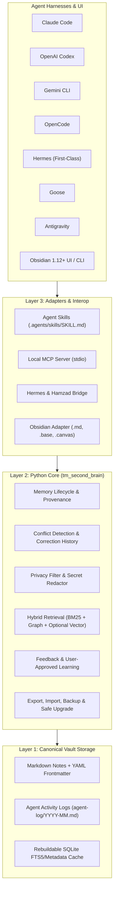

# Architecture: TM Second Brain

> **Project:** `tm-second-brain` (`tmolavi/tm-second-brain`)  
> **Phase:** Phase 2 — Technical Architecture & Feature Mapping  
> **License:** MIT  
> **Date:** 2026-11-12

---

## 1. Architectural Principles

1. **Local-First & Open Formats:** Markdown + YAML frontmatter + wikilinks (`.md`), Obsidian Bases (`.base`), and JSON Canvas (`.canvas`) are the canonical source of truth. Any SQLite index (`.tm-brain/index.db`) is a **rebuildable cache**, never the sole store.
2. **Zero Mandatory External Dependencies:** The core runs on **Python 3.10+ standard library** (`sqlite3`, `json`, `pathlib`, `re`, `hashlib`, `math`, `http.server`). Works identically on **macOS, Linux, and Windows**.
3. **Free-First, No Mandatory API Subscription:** Built-in BM25 + wikilink graph retrieval costs **$0.00**. Semantic embeddings/reranking (QMD, Ollama, Gemini Free Tier) are strictly optional adapters.
4. **Agent-Agnostic Core:** No proprietary agent SDK in `tm_second_brain/core/` or `tm_second_brain/memory/`. All harnesses connect via `AGENTS.md`, standard Agent Skills (`SKILL.md`), CLI, or MCP.
5. **Non-Duplication with Hamzad & Hermes:** `tm-second-brain` does **not** reimplement or replace Hamzad's runtime `MemoryService` or modify existing Hamzad/Hermes production installations. It bridges to them via an optional `HamzadMemoryBridge` / `HermesAdapter`.
6. **Transparent Learning with Human Approval:** Repeated corrections generate **L1 Draft** proposals; mutating `SKILL.md`, `AGENTS.md`, or canonical rules requires explicit **L2 User Approval**.

---

## 2. High-Level Layered Architecture



---

## 3. Core Subsystems (`tm_second_brain`)

### 3.1 Memory Lifecycle, Provenance & Isolation (`memory/`)
Every durable memory note in `memories/` (or project-scoped `projects/<id>/memories/`) is stored as Markdown with structured YAML frontmatter:

```yaml
---
id: mem_20261112_a1b2c3
title: "Use WAL mode for concurrent SQLite readers"
status: active                # draft | active | superseded | archived
scope: project                # general | platform | project
projects: ["tm-second-brain"]
platforms: ["python", "sqlite"]
confidence: verified          # verified | inferred | unverified
verification: "Verified with pytest concurrent reader test"
source_agent: hermes          # claude-code | codex | gemini | opencode | hermes | goose | antigravity | human
origin: "/path/to/repo"       # derived server/CLI-side, never blindly trusted
created: "2026-11-12T06:00:00Z"
updated: "2026-11-12T06:00:00Z"
supersedes: null              # ID of previous memory if this is a correction
superseded_by: null           # ID of newer memory if superseded
private: false
tags: [sqlite, concurrency]
---
```

* **Lifecycle States:** `draft` → `active` → `superseded` → `archived`.
* **Project-Scoped Isolation:** Queries from project `X` only receive `scope: project` memories matching `projects: [X]`, `scope: platform` memories matching the stack, and `scope: general` memories (which require a `generality` justification).
* **Conflict Detection & Correction History:**
  * Before writing a new memory, the engine checks existing active memories in the same scope/project for lexical/topic overlap or contradictory assertions.
  * Corrections **never silently overwrite**; they create a new memory with `supersedes: <old_id>`, mark the old memory `status: superseded` + `superseded_by: <new_id>`, and append an entry to `corrections-history.jsonl` / Markdown audit trail.

### 3.2 Hybrid Retrieval (`retrieval/`)
Pluggable `RetrievalBackend` interface with graceful degradation:
1. **Tier 0 (Built-in, $0.00, Zero Deps):** SQLite FTS5 / pure-Python BM25 lexical scoring + **wikilink graph expansion** (`expand` traverses `[[links]]` and backlinks) + recency/confidence weighting.
2. **Tier 1 (Optional Local Semantic):** `@tobilu/qmd` subprocess/MCP adapter or local **Ollama** embeddings (`nomic-embed-text`, `embeddinggemma`).
3. **Tier 2 (Optional Cloud Free Tier):** User-configured Gemini Free Tier / Groq (never enabled silently; respects privacy exclusions).

### 3.3 Privacy Controls & Sensitive-Data Exclusion (`privacy/`)
Enforced at **every** read, search, MCP response, and export boundary:
1. **Folder & Tag Exclusion:** Notes with `private: true` frontmatter or inside configured `private_paths` (e.g. `Areas/Personal/`, `.env*`) are **never** returned to external/cross-repo MCP callers or cloud LLM providers.
2. **Secret & PII Redaction:** Built-in regex scanner scrubs API keys (`sk-*`, `ghp_*`, `AIza*`, `xoxb-*`), bearer tokens, private keys, and configurable PII patterns before logging or external dispatch.
3. **Auditability:** Every cross-repo read and redaction event is recorded in `working-dir/agent-log/YYYY-MM.md`.

### 3.4 User-Approved Learning (`learning/`)
* Adapts `obsidian-agent-vault-template`'s `FEEDBACK.md` + `skill_health.py` pattern:
  * Agent runs log outcomes and user corrections into per-skill `FEEDBACK.md` (or structured feedback records).
  * When a correction pattern repeats ($\ge 2$ occurrences by default), `tm-brain learn review` generates an **L1 Draft Proposal** (diff to `SKILL.md` or `AGENTS.md`).
  * **L2 Human Approval Gate:** No `SKILL.md`, `AGENTS.md`, or core rule is modified automatically without explicit user approval (`tm-brain learn approve <proposal_id>`).

### 3.5 Export, Import, Backup & Safe Upgrade (`backup/`)
* **Manifest-Driven Separation (`vault-manifest.json`):** Strictly separates `infrastructure` (skills, schemas, scripts) from `user_content_roots` (notes, goals, projects, memories).
* **BYOV (`/adopt`):** Maps onto an existing Obsidian vault without moving or renaming user folders.
* **Backup & Restore:** Deterministic `.tar.gz` / `.zip` + JSON bundle export/import with SHA-256 manifest verification.
* **Safe Upgrade:** Creates a timestamped backup before updating infrastructure files and never overwrites `user_content_roots`.

---

## 4. Ecosystem & Adapter Contracts

| Target | Integration Mechanism | Notes |
|---|---|---|
| **Obsidian 1.12+** | `.md`, `.base`, `.canvas` + optional `obsidian` CLI | Vault works 100% as plain files even without Obsidian open. |
| **Claude Code** | `CLAUDE.md` pointer → `AGENTS.md`, `.claude/skills/`, MCP | Thin adapter; no Claude-only core logic. |
| **OpenAI Codex** | `AGENTS.md`, `.agents/skills/`, `.codex/hooks.json` | Native `AGENTS.md` + standard skill discovery. |
| **Gemini CLI** | `.gemini/settings.json` (`context.fileName: AGENTS.md`), `.gemini/commands/*.toml` | Generated TOML command wrappers. |
| **OpenCode** | `.opencode/skills/` or `.agents/skills/` + `AGENTS.md` | Standard Agent Skills spec. |
| **Goose** | MCP server (`stdio`) + `AGENTS.md` / `.goosehints` | Exposes `search`, `expand`, `recall`, `remember`, `health`. |
| **Antigravity** | `AGENTS.md` (kept <22 KB) + `.agents/skills/` + MCP | Respects Antigravity's instruction-size ceiling. |
| **Hermes (First-Class)** | `HermesMemoryAdapter` + `molavi-agentic-os` `HermesAdapter` format | Reads/writes Hermes-compatible skill & context payloads; never mutates existing Hermes prod installs. |
| **Hamzad (First-Class)** | `HamzadMemoryBridge` implementing `MemoryInterface` (`store_episode`, `get_episodes`, `set_key`, `get_key`) | Optional sync/bridge to `molavi-agentic-os` `SQLiteMemoryStore` & Hamzad `MemoryService` without duplicating `MemoryService`. |

---

## 4.1 Environment Isolation & Ownership Matrix (Critical Amendment)

`tm-second-brain` enforces strict boundaries between **four** distinct integration targets:

| Target Environment | Execution Host | Source of Truth & Ownership | Default Cross-Env Access | Adapter Class |
|---|---|---|---|---|
| **Hamzad Core** | Production server (`MemoryService` + orchestration) | Hamzad `MemoryService` owns live operational episodes/KV; vault stores durable human-readable project knowledge. | **Isolated** (opt-in `HamzadBridge` sync only) | `HamzadBridge` |
| **Main Hermes** | Finland server (integrated with Hamzad) | Preserves its own production identity, tools, workflows, and operational memory (`env:main-hermes`). | **Isolated** (`allow_cross_env_read=False`) | `MainHermesAdapter` |
| **Hermes Personal Desktop** | Mac local desktop | Independent personal memory and identity (`env:hermes-personal-desktop`). | **Isolated**; controlled exchange via explicit `export_controlled_exchange()` | `HermesPersonalDesktopAdapter` |
| **Coding Agents** | Local CLI / IDE (Codex, Claude Code, Gemini CLI, OpenCode, Goose, Antigravity) | Vault Markdown (`memories/`, `AGENTS.md`) via `HarnessAdapter` + stdio MCP. | Project-scoped + privacy-filtered | `GenericHarnessAdapter` |

---

## 5. Architectural Decisions: Reuse vs. Rewrite vs. Adapter

* **REUSE:** Obsidian Markdown/Bases/Canvas specifications (`kepano/obsidian-skills`), Goal-Cascade & Review templates (`obsidian-claude-pkm`), PARA/Area/Project `index.md` + `progress-log.md` + `agent-log` + `FEEDBACK.md` conventions (`claudesidian`, `obsidian-agent-vault-template`).
* **REWRITE (Original Python 3.10+):** Memory lifecycle engine, provenance/confidence validator, conflict detector & correction history, project-scoped isolation, pure-Python BM25 + graph retrieval, privacy/secret redactor, L1→L2 learning approval gate, and cross-platform CLI/backup/upgrade engine.
* **INTEGRATE VIA ADAPTERS:** `@tobilu/qmd`, Ollama, Obsidian CLI, all 7 coding-agent harnesses, Hermes, and Hamzad `MemoryService`.
